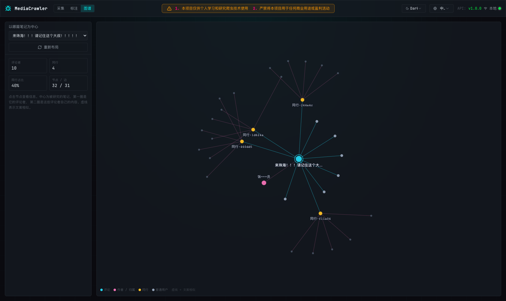
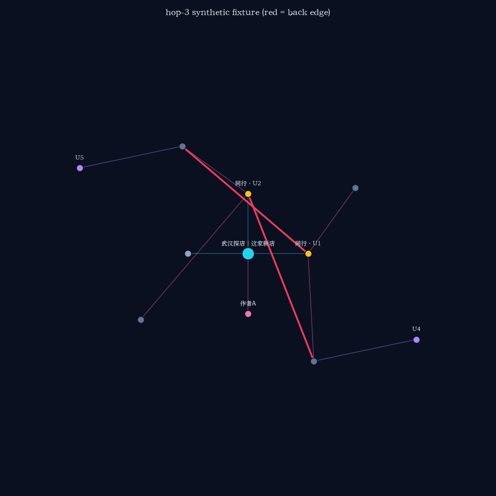
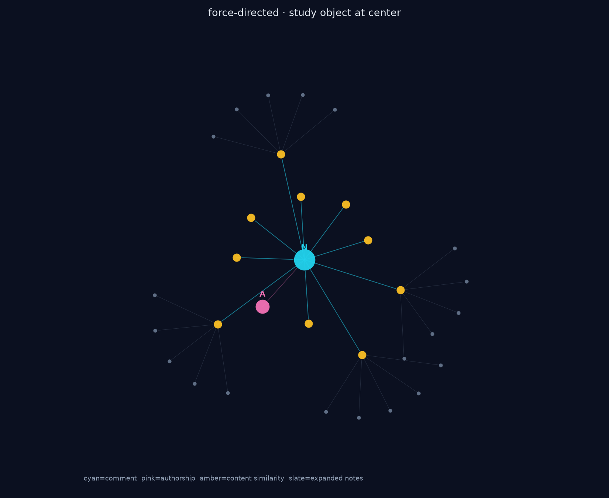

# 标注工作台与关系图谱

> 本地工具说明。对应代码：`api/routers/label.py`、`webui/src/components/label/`、`webui/src/components/graph/`。
> 定位：把已经落盘的采集数据变成可阅读的帖子，人工打判据，并按评论区/同作者关系做二跳三跳的图探索。

## 1. 启动

```bash
# 终端 1：API
uv run uvicorn api.main:app --port 8080 --reload

# 终端 2：前端（开发模式）
cd webui && npm run dev     # http://localhost:5173
```

或先 `cd webui && npm run build`（产物在 `api/webui/`），然后直接访问 `http://127.0.0.1:8080`。

顶部导航新增两个视图：**标注**（逐篇打判据）、**图谱**（按笔记展开评论者关系）。

## 2. 标注工作台


左侧是帖子列表（按发布时间倒序），中间是小红书式的图文/评论预览，右侧是五条判据：

| 判据 | 权重 | 说明 |
|---|---|---|
| A 摆拍图片 | 25 | 菜品数超过碗筷数 / 正对视角 / 看镜头 / 无使用痕迹 |
| B 主页历史 | 25 | 短时间跨城 / 全是探店 / 模板雷同 |
| D 矩阵 | 25 | 评论区互评闭合 / 同批账号反复共现 |
| C 语言风格 | 15 | 情绪高但零信息、零抱怨（仅作旁证） |
| E 互动比值 | 10 | 评论/赞 极低，需与同品类基线比较 |

- 每条判据有 0/1/2 三档（未见/可疑/明显），结论分 `正常 / 疑似 / 强疑似`；右上角分数只用于排序。
- 支持"保存"与"保存并下一条"；**未保存的草稿会存在 localStorage**，切换视图或刷新页面不会丢。
- 支持"只看未标"，方便在标注积累后继续推进。
- 标注落盘在 `data/label/verdicts.jsonl`，**append-only**：同一 note 以最后一条为准，历史记录不会被覆盖丢失。

> 注意：单篇笔记不构成结论。判据表是"暂时的尺子"，权重没有统计依据；真正的主张单位是"锚点 × 时间窗 × 账号群"，见 [软广判据-heuristics.md](软广判据-heuristics.md) 与 [卷宗-异常检测实践.md](卷宗-异常检测实践.md)。

## 3. 关系图谱



以一篇笔记为中心：

- **0 跳**：中心笔记；**1 跳**：笔记作者 + 评论者；
- **2 跳**：评论者自己发布的内容；
- **3 跳**：这些同行笔记评论区里再次出现的人（用来观察跨笔记共现/回流）。

左侧指标里的"共享评论者 / 回流边 / 第三跳用户"就是用来判断“同一批人是否反复出现在同一批店下面”的。图里有五类节点和三种边（评论 / 归属 / 文案相似），图例已标注；文案相似用虚线，同人回流用红线。



上图由 `python -m tools.synth_hop3_check` 生成：用一组可控的假数据验证第三跳节点、回流边和三个指标的计算（跑完自动删除合成数据，`--keep` 可保留）。



> 图布局是浏览器端手写的径向力导向（Canvas 2D，无第三方图库）。当前数据规模（几十个节点）下足够快；节点数到几百时会明显变慢，属于已知限制。

## 4. 二跳采集：边表

图里的评论者默认只有 `creator_hash`（脱敏）。为了能点回主页做二跳，需要可选的边表：

```bash
# 采集时开启（默认关闭）
SOFTAD_EDGE_MAP=1 uv run main.py --platform xhs --type search ...
```

- 边表写到 `data/xhs/edges/user_map.jsonl`，只有 `hash / user_id / kind / ts` 四个字段；
- 默认关闭，只记录身份指针，不写入昵称、头像、内容；
- 它是临时跳板，不是资产：用完可 `python -m tools.softad_edges prune --days 7`，或直接删除 `data/xhs/edges/`。

```bash
# 给一篇笔记列出前排评论者的主页链接
python -m tools.softad_edges expand --note <note_id> --limit 5
```

## 5. 已知限制

- 图谱的"同行"是启发式：按作者历史里"探店/美食"类内容占比判断，阈值未经标注集校准，"同行占比"只能当线索。
- 内容相似用 3-gram Jaccard（阈值 0.34），只用于提示，不是判据。
- 判据权重（25/25/25/15/10）是拍的；后续应当用标注数据算区分度再重排。
- 工作台是逐篇打分，不代表"单篇可判定"；它只是簇研究里的采样与记录工具。
