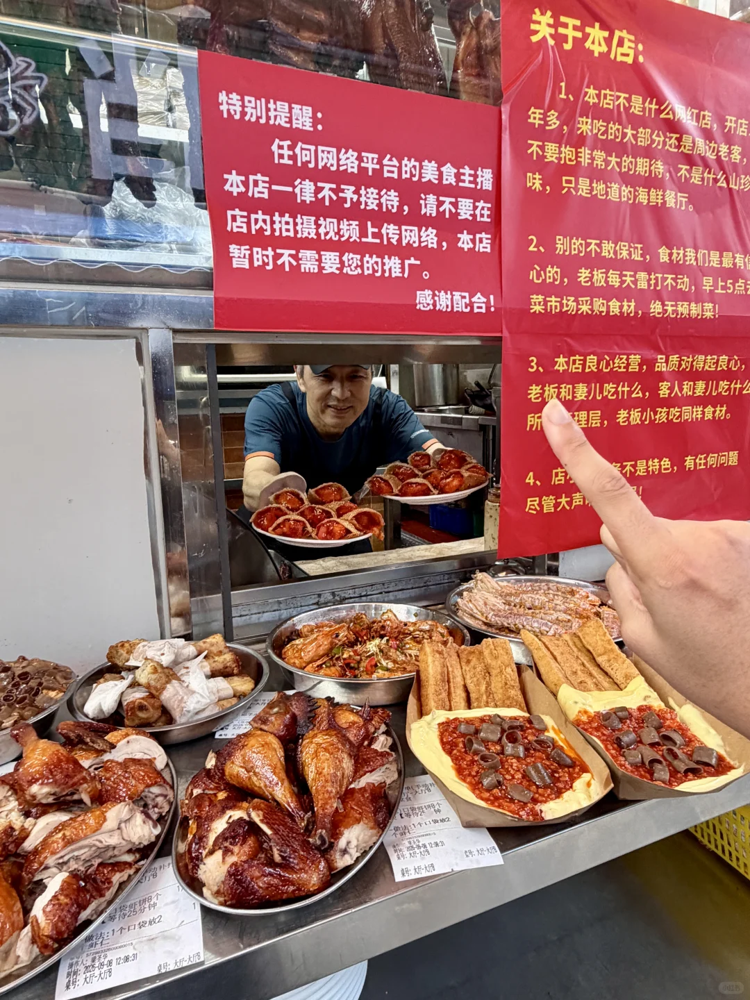

# 案例 01：单个探店账号的画像（不是簇判定）

> 采集时间：2026-10-20 15:17–15:25
> 账号：`user_id 642bde93...`，昵称打码 `饭***员`，作者 hash `ac9c359e...`
> 样本：20 篇笔记（时间跨度 35.4 天）、200 条一级评论、约 270 张图片
> 方式：creator 模式，`--max-notes 20 --comments yes --media yes`

---

## 一句话结论

**这个账号的发布行为高度符合「专业探店号 / 投放号」画像，但它是不是某个投放簇的成员，仅凭单个账号不能判定。**

按 v0.1 判据打分：**75 / 100（强疑似）**。分数只代表"值得进一步查"，不代表它是软广。

---

## 一、判据 B｜主页历史：最强的一条

| 指标 | 数值 |
|---|---|
| 发帖频率 | 20 篇 / 35.4 天 = **1.87 天一篇** |
| 内容构成 | **100% 探店 / 美食**，零生活内容 |
| 涉及城市 | 武汉 17、珠海 2、郑州 1 |
| 发布时间 | 集中在 14:00 与 22:00 两个峰 |

**时间-地点序列：**

```
09-14 武汉  09-16 珠海(×2)  09-19 武汉  09-21 武汉(×2)  09-22 武汉(×2)
09-24 武汉(×2)  09-25 武汉  09-26 郑州  09-27 武汉  09-28 武汉
10-01 武汉  10-06 武汉  10-12 武汉  10-13 武汉  10-19 武汉
```

两个"地理跳跃"：

- 珠海 9/16 22:34 → 武汉 9/19 15:18：**3 天内跨 1100 公里**，随后 8 天连发 7 篇武汉本地店
- 郑州 9/26 10:30 → 武汉 9/27 23:57：**37 小时内两城**，高铁约 2 小时，物理上可行

**判定：L2（结构异常），未达 L1。** 高铁让"次日跨城"成为可能，所以不能写成"不可能"。但一个自称"本地人推荐"（出现 13 次）的账号，35 天内横跨三省，与其自我定位冲突。

**模板化证据（最硬）：**

| 标题 | 发布 |
|---|---|
| 武汉！！**八一路**！！慕名而来的**吼吼吃**！！！ | 10-19 |
| 武汉！！**南京路**！！慕名而来的**吼吼吃**！！！ | 09-27 |

同一句式、同一个生造词，相隔 22 天，只换路名。这不像是重复的口癖，更像是**填模板**。

---

## 二、判据 A｜摆拍：两条独立线索

**线索 1：店家门口明牌拒绝拍摄，但内容存在。**



珠海那篇（`6aa94fda...`）的首图里，红色告示写着：

> "任何网络平台的美食主播本店一律不予接待，请不要在店内拍摄视频上传网络，本店暂时不需要您的推广。"

而这条笔记确实发布了。两种解释：账号无视店家，或者**素材不是本人当场拍的**。无论哪种，都说明"本人到店体验"这个前提不成立——而这正是探店内容可信度的全部基础。

**线索 2：商拍质感。**

- 每篇 **9–18 张图**（中位 14），普通用户通常 1–3 张
- 构图、布光、蒸汽、桌面整洁度都是商业摄影水准，无人、无杂物、无使用痕迹
- 首图多为"展示位"视角：火锅正上方俯拍、档口摆满熟食、后厨人员端盘配合

**判定：L1（自相矛盾）+ L2（商拍特征）。** 第一条是这次最值得记的发现：**告示本身就构成了证据**。

---

## 三、判据 C｜语言：模板词密集，但"零抱怨"不成立

| 模板词 | 命中 |
|---|---|
| 本地人 | 13 / 20 |
| 吼吼吃 | 8 / 20 |
| N 刷（5刷、7刷） | 7 / 20 |
| 宝藏 | 5 / 20 |
| 慕名而来 | 2 / 20 |

- 标题感叹号 0–8 个，正文 emoji 中位 4.5
- **提价格 / 团购 / 人均：仅 3 / 20** → "零数字"倾向明显
- **出现"但 / 排队 / 略贵"等负面表述：8 / 20** → **"零抱怨"这条判据在本账号上不成立**

这次标注的一个重要收获：**假设被证伪了。** 我原以为"通篇无缺点"是硬判据，但这个账号有 8 篇带微词。它依然模板化，但不是"全好评"型。v0.2 应当把"零抱怨"降级。

---

## 四、判据 D｜矩阵：一层干净，需要二跳

| 指标 | 数值 |
|---|---|
| 评论总数 | 200（每篇恰好 10 条 = 采集上限，**不能推断总量**） |
| 独立评论者 | 111 |
| 重复出现 >1 次 | 40 人 |
| 最高重复 | 1 人 7 次 |

评论内容是**真实提问型**："p3 是啥？""人均多少啊""码住""图五是什么呀"——不像互评夸赞。

**判定：未见互评闭合（L0），但样本受限。** 那 40 个重复账号还没看主页，这是下一步唯一必须做的事。

---

## 五、判据 E｜互动比：一个异常值

| 指标 | 中位 |
|---|---|
| 赞 | 1241 |
| 藏 | 830 |
| 评 | 60 |
| **转** | **677** |
| 藏/赞 | 0.66（攻略类正常偏高） |
| 评/赞 | 0.048（偏低） |
| **转/赞** | **0.55** |

**转/赞 0.55 是我最在意的一个数。** 正常 UGC 的转发远低于点赞；这里转发接近点赞的一半，只有两种解释：内容被大量"转给朋友一起去"，或者转发量被运营过。

---

## 六、这次没做的事（必须说清楚）

- **没有做簇判定**。我们没有采同城同品类的其他账号，所以无法回答"这批账号是否共现于同一批店"。单个账号再可疑，也只是**画像**，不是**簇**。
- **没有做二跳**。那 40 个重复评论者的主页没看。
- **没有 POI 数据**，城市是从标题/正文/话题里提取的，属于文本推断。
- **结论只到行为层面**：不主张收钱、不主张违法、不主张主观故意。

---

## 七、下一步

1. 采这 40 个重复评论者的主页（每人 5 篇即可），看是否存在互评闭合与同批共现
2. 用"武汉 探店 / 武汉 美食"采同城样本 100 篇，看这个账号推的店是否与其他账号重合
3. v0.2 判据修订：降级"零抱怨"，新增"店招/告示与内容矛盾"作为 L1 子项

---

## 八、二跳补充：评论区网络检验（2026-10-20 追加）

### 8.1 一个前提性障碍

MediaCrawler 这个 fork **在存储层就把 user_id 哈希成了 `creator_hash`**（`database/models.py`，并有测试断言原始 user_id 不会落盘）。所以：

**无法用评论者数据直接去采他们的主页。** 这是设计上的隐私选择，不应绕过。

因此二跳改为**在现有数据内部做等价检验**：不采主页，直接检验"这批评论者是不是一伙的"。

### 8.2 共现检验（含零模型）

把 200 条评论建成 `评论者 × 笔记` 二部图（199 条去重边，111 人，20 篇）：

| 指标 | 观测 | 随机均值 | p |
|---|---|---|---|
| 共同出现 ≥2 篇的账号对 | 58 | 55.0 | 0.35 |
| 共同出现 ≥3 篇的账号对 | 9 | 6.6 | 0.18 |
| 最大连通分量 | 34 人 | 30.6 人 | 0.17 |

**结论：共现结构不显著，与随机重叠无法区分。**

如果不做零模型，会看到"58 对共现、34 人连成一个网络"，很容易误判为"评论团"。实际上 20 篇 × 10 条评论的密度下，这种重叠是必然产生的。

**这是一次教科书式的假阳性，也是本次最重要的方法收获。**

### 8.3 时序检验：出现弱信号

| 分组 | n | 距发布中位 | <1 小时 | <24 小时 |
|---|---|---|---|---|
| 重复评论者 | 127 | **559 分** | 14% | 75% |
| 一次性评论者 | 73 | **2511 分** | 4% | 40% |

最早 8 条评论的发布间隔（分钟）：2、12、13、15、15、16、19、21 —— **全部来自重复评论者**。

解读：早期评论位被同一批人系统性占据。这既可能是控评，也可能是熟客/粉丝，**属于 L2 弱信号，不能单独支撑结论**。

### 8.4 样本限制

每篇只抓到 10 条一级评论（采集上限），而实际评论数中位 60 条。因此：

- 共现分析被严重截断，零模型结论只在"已观测样本内"成立
- 真实评论层的结构可能比这里更强，也可能更弱

### 8.5 v0.2 修订建议

1. 判据 D 的主指标从"共现对数"改为"**早期评论占比**"（可计算、且不依赖主页）
2. 任何图结构指标**必须附零模型基线**，否则不进结论
3. 若要真做二跳，只能人工取样：手工取 5–8 个高频评论者的主页链接，再定向采集

---

## 九、横向共现检验：用同城样本替代"二跳"（2026-10-20 追加）

### 9.1 为什么换方法

`tools/user_hash.py` 明确写明"用户 ID、主页链接一律不采集"，因此**无法从评论者直接采其主页**。但哈希是 `sha256(user_id)[:16]`，无盐且确定性——同一个人跨批次 hash 相同。

所以改用**横向共现**：不采主页，改看"这批评论者是否也出现在同城其他账号的评论区"。

采集：搜索「武汉探店」，40 篇笔记 / 37 个作者，评论 376 人。

### 9.2 结果：没有评论团

| 指标 | 数值 |
|---|---|
| 目标账号评论者 | 111 人 |
| 同城其他 39 篇的评论者 | 376 人 |
| 两者交集 | **4 人** |
| 只在 1 个作者下出现 | 364 / 376（96.8%） |
| 跨 2 个作者 | 6 人 |
| 跨 3 个作者 | 1 人 |
| 交集里的评论者跨作者广度 | 均 ≤2 |

**结论：不存在跨账号的评论团结构。** 4 人的交集，在"武汉美食"这个受众池里属于自然重叠。

### 9.3 判据 D 的三次检验，全部为阴性

1. 账号内共现：58 对、34 人连通分量 → 零模型 p≈0.17–0.35，**与随机无异**
2. 评论时序：重复评论者确实更早（中位 559 分 vs 2511 分）→ 弱信号，可由"熟客/粉丝"解释
3. 横向共现：交集 4 人、无跨作者聚集 → **无评论团**

**判据 D 在本样本上不成立。v0.1 给它打的 1 分应降为 0。**

### 9.4 分数修正

| 判据 | 原 | 现 | 依据 |
|---|---|---|---|
| A 摆拍 | 2 | 2 | 店招矛盾 + 商拍质感 |
| B 主页 | 2 | 2 | 跨 3 城 + 模板填词 + 100% 探店 |
| C 语言 | 1 | 1 | 模板词密集，但 8/20 有微词 |
| D 矩阵 | 1 | **0** | 三项检验均阴性 |
| E 互动 | 1 | 1 | 转/赞 0.55 异常 |

**75 → 67.5（仍属强疑似区间，但性质变了）**

### 9.5 结论的性质变了

这个账号的异常集中在**内容生产**（摆拍、模板、商拍质感）和**行为地理**（跨城），**不在"矩阵"**。

也就是说：它更像一个**专业探店号 / 接商单的账号**，而不是一个刷量矩阵的节点。这两件事在处置上完全不同——前者是内容合规与标识问题，后者是流量造假问题。

**不能把"专业"直接等同于"造假"。** 这是本次最重要的克制。

---

## 十、二跳打通后：判据 D 的结论需要修正（2026-10-20 追加）

### 10.1 打通了什么

在 `store/xhs/__init__.py` 的第 83/135 行旁各加一行 `record_edge(...)`，
当 `SOFTAD_EDGE_MAP=1` 时把 `user_id` 写进独立边表 `data/xhs/edges/user_map.jsonl`。
主数据仍然脱敏，边表默认关闭、只有 hash/user_id/kind/ts 四个字段。

一条笔记的 11 条边（1 作者 + 10 评论者）即可还原出评论者主页链接。

### 10.2 实测：评论区里坐的是同行

对珠海那篇笔记的前 5 个评论者做二跳（每人 5 篇）：

| 评论者 | 内容 | 判定 |
|---|---|---|
| 6790b8f8… | 未采到内容 | 未知 |
| 62fe1e1e… | 宜昌/武汉 美食 4/5 | 疑似同行 |
| 649d82e0… | 珠海本地探店 5/5，城市词 27 次 | **同行，且同城** |
| 61f117f0… | 武汉探店 3/5 | **同行，标题风格最接近目标** |
| 61e10435… | 武汉逛店/女装 | 半同行 |

标题风格量化：双感叹号/篇 —— 目标 1.6，`61f117f0` 1.2，`649d82e0` 1.0，其余 0.2–0.4。

### 10.3 结论修正

第九节说的"无评论团"，**只检验了「评论者之间是否共现」，没有检验「评论者本身是不是同行」**。这是两件事。

修正后：**评论区聚集的是同城 / 同业的探店账号，而不是随机路人。**

但这**不等于**没有协同：

- ~~同业互关、互相捧场是内容生态的常态，不需要有人付钱~~ ← **此判断已被推翻，见第十一节**
- 原定"决定性判据 = 双向性"，同样作废：那是"证明组织"的标准，门槛过高

### 10.4 下一步（决定性实验）

对 3 个已确认为探店号的账号，各抓前 3 篇笔记的评论（带 `SOFTAD_EDGE_MAP=1`），
检查目标账号的 hash `ac9c359e…` 是否出现：

- 出现 ≥2 次 → **双向互动成立**，可判定互推结构（L2）
- 一次都不出现 → 单向捧场，属自然同业关系，判据 D 仍应归零

### 10.5 工程备注

- 边表默认关闭（`SOFTAD_EDGE_MAP=1` 才写），只有 hash / user_id / kind / ts
- 当前体积 1.1 KB / 11 条；`python -m tools.softad_edges prune --days 7` 可清理
- 它是跳板，不是资产：用完即删


---

## 十一、标准重建：证明"联系"，不证明"动机"（2026-10-20 追加）

### 11.1 被推翻的判断

第十节曾写："同业互关、互相捧场是内容生态的常态，不需要有人付钱。"

这句话犯了两个错：

1. **把普遍性当成正当性。** 互相捧场之所以普遍，正因为它低成本、高收益、几乎无惩罚。
2. **把举证门槛设成了"证明交易"。** 这个门槛几乎不可跨越，等于让绝大多数协同行为自动脱罪。

### 11.2 新的判定标准

| | 旧 | 新 |
|---|---|---|
| 要证明 | 有人付钱 | 账号间存在**非随机联系** |
| 可证性 | 几乎不可证 | 可统计检验 |
| 结论 | "收钱发帖" | "协同行为 / 互推结构" |

**损害模型**：不是某个具体的人受损，而是**信号本身失真**。用户用评论区判断"值不值得去"，而这个依据已被同行填满。没有报案人，损害真实存在。

### 11.3 三层指标

**接触层**：同现 / 互评 / 时序同步 / 风格同构
**密度层（核心）**：**评论区同行占比 vs 同城基线**
**效果层**：同行是否占据前排、真实提问是否被压下、互动量是否被抬高

### 11.4 判据 D 修订

- 取消"双向性 ≥2 次"作为命中的必要条件
- 改为：同行占比显著高于同城基线 → 命中
- 需要的不是交易证据，是**基线数据**

### 11.5 待验证

当前只有 5 个样本（3 个同行，60%），**没有基线**。
下一步必须采同城普通笔记的评论者做对照，否则 60% 这个数字没有意义。
